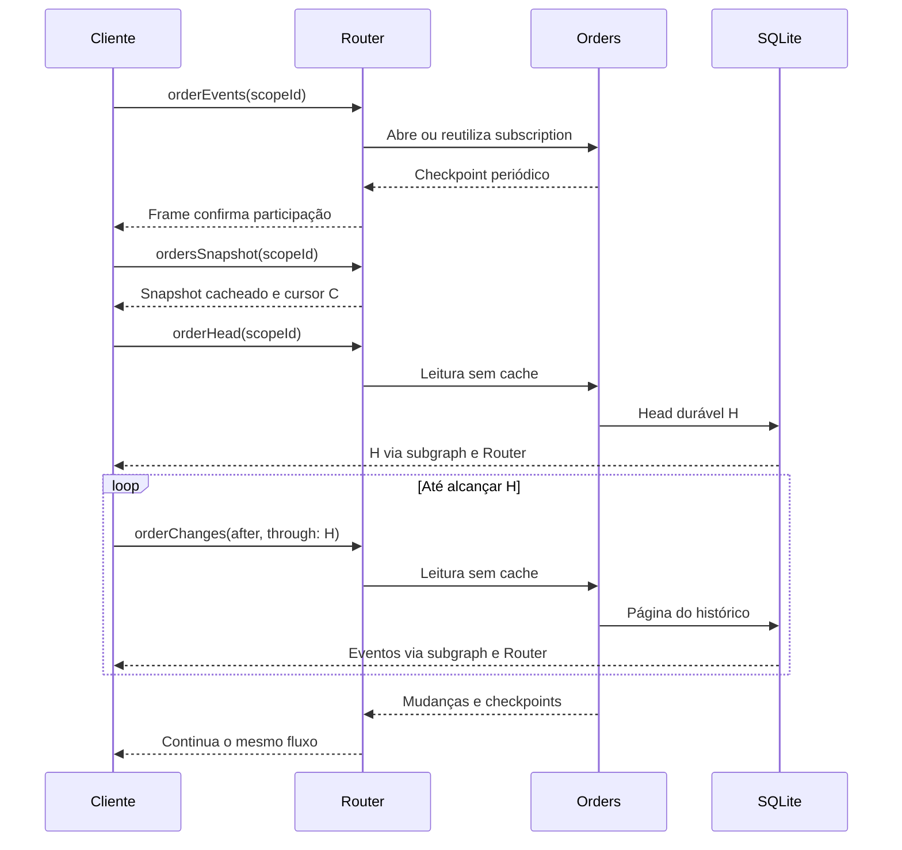

# GraphQL federado: snapshot cacheado + histórico + stream compartilhado

Exemplo de sincronização de pedidos com Apollo Router, dois subgraphs, Redis e
SQLite persistente. O snapshot pode estar antigo nos caches do Router e do
subgraph. O cliente recupera a diferença pelo histórico e continua por uma
subscription sem cursor individual, compatível com deduplicação.

## Comece por aqui

- **Algoritmo:** [`client/sync.mjs`](client/sync.mjs).
- **Persistência e snapshot consistente:** [`src/store.mjs`](src/store.mjs).
- **Resolvers, cache interno e checkpoints:** [`src/server.mjs`](src/server.mjs).
- **Apollo Router:** [`router/router.yaml`](router/router.yaml).
- **Decisões e limites:** [`docs/design.md`](docs/design.md).
- **Validação realizada:** [`docs/validation.md`](docs/validation.md).

## Requisitos

- Node.js 24 ou superior (`node:sqlite` é usado sem módulo nativo externo).
- Docker e Docker Compose para Router + Redis.
- `APOLLO_KEY` e `APOLLO_GRAPH_REF` de um graph GraphOS cuja licença habilite
  federated subscriptions e response caching no Router escolhido.

O projeto usa como referência o **Router 2.10.0**. O YAML foi validado pelo binário
oficial dessa versão. Não representa recomendação de versão para produção:
selecione uma versão homologada e valide o arquivo ao atualizar. O lockfile
registra as versões exatas dos pacotes Node instalados.

## Executar com Router

```bash
npm ci
npm run compose-schema
cp .env.example .env
# Edite APOLLO_KEY e APOLLO_GRAPH_REF no .env.
docker compose up --build -d
```

Endpoints:

| Serviço | Endereço |
| --- | --- |
| Apollo Router | http://localhost:4000/graphql |
| Subgraph orders, HTTP/WS | http://localhost:4001/graphql |
| Subgraph catalog | http://localhost:4002/graphql |
| Contadores didáticos | http://localhost:4001/metrics |

Os dois subgraphs compartilham um processo para reduzir a configuração local;
possuem schemas e endpoints separados. O SQLite fica no volume `orders-data`.

Em um terminal, abra um cliente:

```bash
npm run client
```

Em outro, execute a demonstração:

```bash
npm run demo
```

Ela aquece o snapshot, escreve uma mudança e mostra que o snapshot continua
antigo enquanto `orderHead` já avançou. O cliente converge usando o histórico.
Abra um segundo `npm run client`: ele entra no stream existente e também
sincroniza, sem depender de um snapshot emitido na abertura da subscription.

Para verificar cache, late joiner, deduplicação, eventos novos e reconexão de
forma automática, use uma instância limpa, sem outros clientes conectados:

```bash
npm run test:router
```

O script também compara `/metrics` para exigir uma única subscription ativa
no subgraph enquanto dois clientes recebem eventos. A deduplicação aqui é local
à instância do Router; múltiplas réplicas podem manter conexões distintas.

Para outro escopo/endpoint:

```bash
SCOPE_ID=loja-99 GRAPHQL_URL=http://localhost:4000/graphql npm run client
```

Para parar os serviços preservando o banco:

```bash
docker compose down
```

## Executar os testes sem GraphOS ou Docker

```bash
npm ci
npm test
npm run compose-schema
```

Os testes exercitam transações reais, persistência em disco, replay paginado,
expiração de histórico, concorrência durante bootstrap, duplicatas, lacunas,
reconexão e os endpoints HTTP/WS reais dos subgraphs. Usam as portas 4001/4002;
pare uma instância anterior de `npm start` antes de executá-los.

`npm test` não simula que um Router tenha sido executado. A verificação das
funcionalidades licenciadas é o comando separado `npm run test:router`.

Você também pode iniciar apenas os subgraphs com `npm start`. Para demonstrar
o cache interno sem Router:

```bash
GRAPHQL_URL=http://localhost:4001/graphql npm run demo
```

## Protocolo de sincronização

1. O cliente abre `orderEvents(scopeId)` e espera um frame real do domínio.
2. Busca `ordersSnapshot(scopeId)`, que pode vir antigo, com cursor `C`.
3. Consulta `orderHead(scopeId)` sem cache para obter o limite durável `H`.
4. Aplica páginas de eventos no intervalo `(C, H]` em ordem.
5. Consome os frames recebidos durante o bootstrap, ignorando os já aplicados.
6. Aplica eventos contíguos; diante de lacuna ou checkpoint adiantado, consulta
   o histórico até a posição observada.
7. Após desconexão, preserva o último cursor aplicado e repete a recuperação.
8. Se o cursor expirou, usa `ordersSnapshot(fresh:true)` e sincroniza novamente.



O stream permanece aberto durante as queries. O iterator de transporte conserva
os frames ainda não consumidos. Não há tarefas concorrentes escrevendo o estado
local: bootstrap, replay e aplicação live acontecem sequencialmente.

## Operações para experimentar

Escrever um pedido:

```graphql
mutation {
  upsertOrder(scopeId: "loja-42", id: "order-1", status: "PAID") {
    cursor
    operation
    order { id version status }
  }
}
```

Ler o snapshot cacheável ou exigir um snapshot novo:

```graphql
query {
  cached: ordersSnapshot(scopeId: "loja-42") {
    scopeId cursor
    orders { id version status }
  }
  fresh: ordersSnapshot(scopeId: "loja-42", fresh: true) {
    scopeId cursor
    orders { id version status }
  }
}
```

A operação acima é enviada como `no-store` por incluir `fresh:true`. Para aquecer
o cache do Router, execute uma operação contendo apenas o campo cacheável,
como faz `npm run demo`.

Excluir um pedido:

```graphql
mutation {
  deleteOrder(scopeId: "loja-42", id: "order-1") {
    cursor operation
    order { id version }
  }
}
```

Consultar uma entidade com campos de dois subgraphs:

```graphql
query {
  order(id: "order-1") {
    id
    status
    version
    label
  }
}
```

`status/version` pertencem a orders; `label` pertence a catalog e possui um cache
interno ilustrativo de cinco minutos. Essa consulta ilustrativa usa o escopo
fixo `loja-42`. Ela está separada do contrato de sincronização: `OrderState` é
um value object e não uma entidade que o Router enriquece com campos de épocas
diferentes.

## Limites deliberados

- Exemplo local de estudo, sem autenticação. `scopeId` é um seletor de dados,
  não uma autorização. Em produção, associe escopo e cursor à identidade e
  garanta isolamento em todas as chaves de cache e operações.
- Sem filtros adicionais ou paginação do snapshot. Cada escopo tem uma
  sequência contígua própria. Não reutilize a regra `cursor + 1` para offsets
  globais, logs particionados ou streams filtrados.
- SQLite tem um escritor por vez. Não compartilhe este arquivo via filesystem
  de rede entre réplicas. Para escalar, adapte a transação para uma fonte
  compartilhada, como PostgreSQL, e um mecanismo de distribuição apropriado.
- O log é a fonte durável para o stream; o publisher local faz polling a cada
  500 ms. Não há confirmação de processamento de cada cliente nem promessa de
  exactly-once. O replay é idempotente pela sequência aplicada.
- O histórico não é removido automaticamente. `Store.prune()` existe para
  exercitar retenção e `CURSOR_EXPIRED` nos testes; defina sua política real.
- O cliente mantém estado em memória. Para sobreviver ao reinício do cliente,
  persista **estado e cursor juntos**; persistir apenas o cursor perde a base.
- O cliente limita uma parte multipart a 4 MB e reconecta após 15 s sem
  progresso. Produção precisa de limites e observabilidade adequados à carga.
- `include_subgraph_errors` está ligado para o cliente receber
  `CURSOR_EXPIRED`. Em produção, exponha somente os erros públicos previstos.

## Referências oficiais

- [Subscriptions e deduplicação](https://www.apollographql.com/docs/graphos/routing/operations/subscriptions/configuration)
- [Response caching](https://www.apollographql.com/docs/graphos/routing/performance/caching/response-caching/quickstart)
- [Persistência de eventos e retomada](https://www.apollographql.com/docs/graphos/routing/operations/subscriptions/guaranteed-delivery)

## Git

Clone o repositório:

```bash
git clone https://github.com/tpisani/poc-graphql-subscriptions.git
cd poc-graphql-subscriptions
```

O pacote ZIP entregue anteriormente também contém o código em `source/` e um
bundle Git do estado inicial. Nenhuma credencial ou arquivo `.env` está
versionado.
