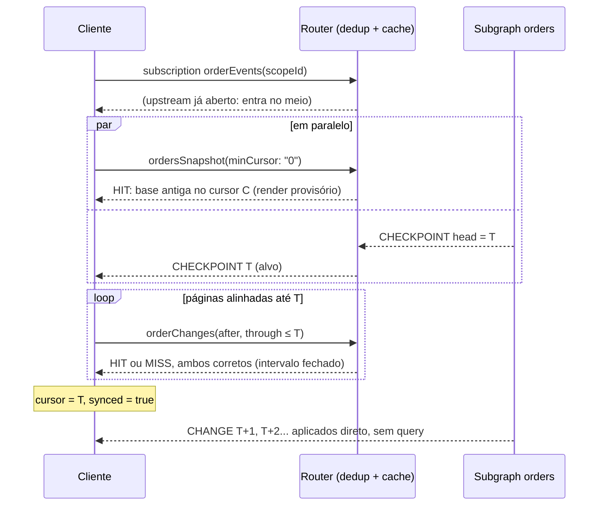

# Desenho: tempo real com deduplicação no Router e queries cacheáveis

## Requisitos

1. **Conviver com a deduplicação de subscriptions do Apollo Router.** Clientes
   com a mesma operação e as mesmas variáveis compartilham um único upstream.
   Quem entra depois recebe só os frames seguintes; nada é reenviado na entrada.
2. **Tolerar cache em qualquer query** (response cache do Router, CDN, cache
   interno do subgraph), mesmo com TTLs longos ou configurados errado.
3. **Estado inicial consistente e atual:** o cliente nunca mostra uma mistura
   de épocas e não fica preso a um snapshot antigo vindo do cache.
4. **Tempo real:** eventos ao vivo aplicados direto do stream, sem polling e
   sem query no caminho quente.

## Ideia central: separar fatos de "agora"

Uma resposta cacheada só fica errada quando afirma algo que muda com o tempo,
como "o estado atual" ou "o head". Então nenhuma query responde isso. Toda query
responde um **fato** que, depois de verdadeiro, continua verdadeiro:

| Campo | Contrato | Cache-Control do subgraph | Por que é seguro cachear |
| --- | --- | --- | --- |
| `ordersSnapshot(scopeId, minCursor: "0")` | um estado consistente em algum cursor ≥ 0 | `public, max-age=60` | qualquer snapshot já gerado satisfaz o contrato; o TTL só limita quanto replay ele exige |
| `ordersSnapshot(scopeId, minCursor: T)` | um estado consistente em algum cursor ≥ T | `public, max-age=86400` | idem; e a chave é nova a cada T, então nenhum valor antigo a satisfaz |
| `orderChanges(scopeId, after, through)` | os eventos `(after, through]`; exige `through ≤ head` | `public, max-age=31536000, immutable` | um intervalo fechado do log nunca muda |
| mutations, erros (`NOT_YET`, `CURSOR_EXPIRED`) | — | `no-store` | o Router não cacheia erros |
| `Order.label` (catalog) | dado de referência | `public, max-age=300` | consistência eventual, separado do estado versionado |

**O "agora" vem só do stream**, que nenhum cache de query toca:

```graphql
subscription OrderEvents($scopeId: ID!) {
  orderEvents(scopeId: $scopeId) { scopeId kind cursor change { ... } }
}
```

- `CHANGE`: empurrado no commit (bus em memória, sem polling).
- `CHECKPOINT`: o head durável, a cada `CHECKPOINT_MS` (padrão 250 ms), lido
  uma vez por escopo e não por assinante. É a prova de que o stream está vivo,
  o alvo de sincronização e o detector de perdas.

A subscription tem só `scopeId`, então todos os clientes do escopo mandam as
mesmas variáveis e o Router deduplica. Um late joiner que pega o stream no meio
não perde nada, porque o passado não vem do stream.

## Algoritmo do cliente (`client/sync.mjs`)



1. Abre o stream e, **em paralelo**, pede a base compartilhada
   `ordersSnapshot(minCursor: "0")`, a chave com mais chance de estar no cache.
   Se ela chegar primeiro, a tela renderiza na hora como **provisória**: um
   estado consistente, mas possivelmente antigo.
2. O primeiro frame (CHECKPOINT ou CHANGE) dá o alvo `T`: o stream provou que o
   head é ao menos `T`, e todo commit depois disso vai chegar por ele.
3. Aplica `(C, T]` por páginas de `orderChanges`. As páginas são alinhadas em
   múltiplos de 100, para que clientes em cursores diferentes peçam as mesmas
   chaves e as páginas completas fiquem compartilhadas no cache.
4. Atalhos de recuperação, ambos com uma **chave nova** (`minCursor = T`):
   - se `T - C > maxReplay` (padrão 2000), pede um snapshot em vez de replay;
   - se o histórico de `C` foi podado (`CURSOR_EXPIRED`), idem.
5. Com `cursor ≥ T`: **synced**. Daqui em diante:
   - `CHANGE` com `seq = cursor + 1`: aplicado direto do frame, sem query;
   - `seq ≤ cursor`: ignorado (reentrega/sobreposição);
   - `CHECKPOINT` ou `CHANGE` acima de `cursor + 1`: perda detectada,
     catch-up pelo histórico até o novo alvo.
6. Queda do stream ou silêncio maior que `stallMs` (padrão 5 s, ou 20
   checkpoints): reconecta com backoff, mantendo o estado. A retomada é o mesmo
   catch-up do passo 3, sem snapshot.

### Por que o estado inicial nunca fica defasado

- **Consistência:** o estado local só muda por (a) um snapshot inteiro, lido
  com o cursor na mesma transação, ou (b) eventos com `seq = cursor + 1`.
  Logo, ele é sempre o estado exato do banco em `cursor`.
- **Atualidade:** "synced" só é declarado com `cursor ≥ T`, onde `T` vem do
  stream e não de um cache. Um cache pode atrasar a *base* (mais replay), nunca
  o *alvo*.
- **Cache antigo não prende o cliente:** toda nova busca usa uma chave que
  nenhuma resposta antiga satisfaz: `minCursor = T` ou um intervalo que
  termina em `T`. E toda resposta que existe numa dessas chaves é verdadeira.
- **Defesas contra um cache quebrado:** se um cache devolver um snapshot com
  `cursor < minCursor`, ou uma página com buraco, o cliente rejeita, em vez
  de aceitar dados errados.

Teste de propriedade em `tests/sync.test.mjs`:
- **Condições:** 25 sementes, cache eterno que ignora `Cache-Control`, frames
  perdidos, duplicados e reordenados, clientes entrando e reconectando em
  qualquer momento, retenção podando o log.
- **Verificação:** todos terminam no estado exato do banco.
- **Sensibilidade:** introduzir de propósito um bug (aplicar `CHANGE` com
  lacuna) faz o teste falhar na primeira semente.

### Garantias e o que elas custam

| Momento | Garantia |
| --- | --- |
| Antes do primeiro frame | estado consistente, possivelmente antigo (`synced: false`) |
| Bootstrap | até `CHECKPOINT_MS` + o catch-up. Medido com 50 clientes partindo de uma base 400 eventos atrás: p50 491 ms |
| Ao vivo | latência do push. Medido: p50 5 ms, p99 11 ms (50 clientes, 50 commits/s) |
| Perda no stream (bus, fila cheia) | corrigida no próximo frame (≤ `CHECKPOINT_MS`) pelo histórico |
| Retomada | um catch-up a partir do cursor, sem snapshot |

O intervalo do checkpoint é o único botão entre bootstrap rápido e custo:
4 frames pequenos por segundo por cliente e 4 leituras de head por segundo por
escopo ativo (não por cliente). Para muitos escopos num banco compartilhado,
derive o checkpoint do head em memória e leia o banco com menos frequência.

## Servidor

- **Escrita:** projeção, evento e head numa transação `BEGIN IMMEDIATE`. O
  evento só é publicado no bus depois do `COMMIT`.
- **Hub (`src/live.mjs`):** um timer de checkpoint por escopo com assinantes;
  ele morre com o último assinante. Com a deduplicação no Router, normalmente
  há um único assinante por escopo e por instância do Router.
- **Fila por stream com conflação:** se o consumidor não acompanha
  (`QUEUE_LIMIT`, padrão 1000), os frames pendentes viram um único
  `CHECKPOINT` com o head. O stream fica com perda; o cliente não, porque o
  checkpoint acima do cursor dispara o catch-up. Desconectar seria pior sob
  deduplicação: o Router derrubaria todos os clientes daquele upstream.
- **`SnapshotCache`:** devolve qualquer snapshot em memória que satisfaça
  `minCursor` e só lê o banco quando o que tem é antigo demais, ou quando o TTL
  interno expirou.
- **Bus distribuído:** se o adaptador (Redis, NATS, `LISTEN/NOTIFY`) perder
  ou reordenar mensagens, o cliente corrige pelo log; o bus nunca é a fonte de
  verdade.

## Apollo Router

`router/router.yaml` (validado com `router config validate` do Router 2.10.0):
- `subscription.deduplication.enabled: true` (o padrão, explícito);
- passthrough `graphql_ws` para o subgraph orders;
- `response_cache` com Redis; o TTL vem do `Cache-Control` de cada resposta do
  subgraph;
- `include_subgraph_errors`, para o cliente receber `CURSOR_EXPIRED` e `NOT_YET`.

Pontos de atenção:
- **Headers entram na chave de deduplicação.** Clientes com `Authorization`
  diferentes não compartilham upstream. `deduplication.ignored_headers` só é
  seguro se esses headers não mudam o que o subgraph pode enviar.
- **Autorização por escopo** precisa valer no `subscribe` e também nas
  queries, porque a chave de cache não carrega a identidade a menos que você
  a inclua.
- **Réplicas do Router:** cada instância tem o seu upstream deduplicado. A
  retomada funciona em qualquer uma, porque o cursor está no cliente.
- **Réplicas de leitura defasadas no subgraph:** `NOT_YET` (alvo acima do
  head local) não é cacheado. O cliente reconecta e tenta de novo.

## Emulação usada nos testes (`scripts/edge.mjs`)

As subscriptions federadas e o response cache do Router exigem licença
GraphOS. O binário recusa iniciar sem ela ("license violation: Federated
subscriptions"). Para testar sem licença, `scripts/edge.mjs` fica na frente do
Hive Gateway e reproduz os dois comportamentos que importam:
- **Deduplicação:** mesma operação + variáveis = um upstream; quem entra
  depois só recebe os frames seguintes.
- **Cache de queries no pior caso:** toda query bem-sucedida fica cacheada
  para sempre, ignorando `Cache-Control`. Se o protocolo funciona aqui,
  funciona com o TTL que o Router respeita.

Ele expõe subscriptions no multipart do Router (`subscriptionSpec="1.0"`). É
uma emulação, não o Router; `npm run test:router` roda o mesmo cenário
(`scripts/verify.mjs`) contra um Router de verdade.

## Enriquecimento federado

`OrderState.details` traz `label` do subgraph catalog. Sem deduplicação, o
gateway resolve isso por assinante e por frame. Com 50 clientes a 50 commits/s,
a latência p50 foi de 47 ms (p99 92 ms); numa rodada anterior, mais carregada,
chegou a 371 ms. Com deduplicação, é resolvido uma vez por evento para todos:
p50 7 ms (p99 13 ms). O campo continua com cache de entidade próprio
(`max-age=300`), separado do estado versionado.

## Evolução neste branch

- `main` (versão do Codex): subscription compartilhada, mas com polling de 500 ms no
  subgraph e bootstrap em várias queries (snapshot, `orderHead` sem cache,
  páginas). A dependência de um `orderHead` sem cache é o que este desenho
  elimina: o head vem do stream.
- Commit `15a917e` deste branch: `orderFeed(scopeId, after)`, com push e o
  estado inicial dentro da subscription. Tem uma latência de bootstrap menor,
  mas é **incompatível com a deduplicação**: um late joiner não recebe o
  SNAPSHOT e entra em loop de reconexão.
- Atual: push no stream compartilhado e recuperação por queries com
  contratos imutáveis.
