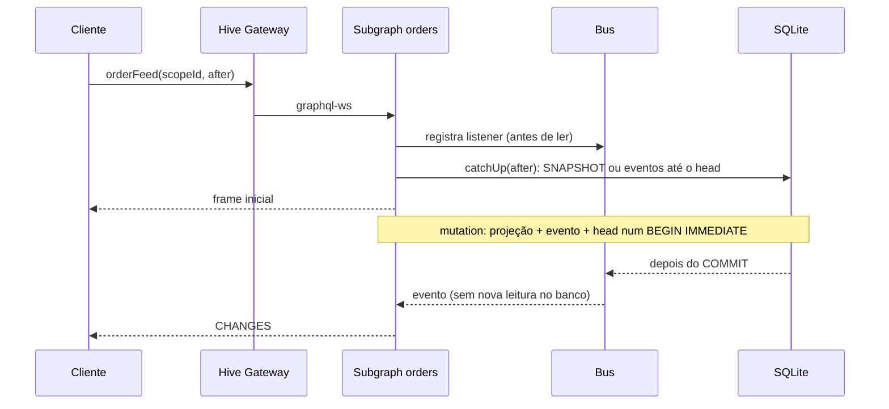

# Decisões: feed em tempo real com retomada por cursor

## Objetivo

Levar cada commit ao cliente com a menor latência possível e com uma garantia
simples: **o estado local é sempre igual ao estado do banco em algum cursor**,
mesmo com quedas de rede, reinício do subgraph, clientes lentos ou entrando
com o sistema já em movimento.

## O que mudou em relação à versão em `main`

| Tema | `main` | Este branch |
| --- | --- | --- |
| Origem dos eventos ao vivo | Cada subscription faz polling do SQLite a cada 500 ms | Push: commit → bus em memória → assinantes, sem polling |
| Latência mínima | Até 500 ms só de espera no polling | Limitada pela rede e pelo gateway (ms) |
| Bootstrap do cliente | Abre o stream, query de snapshot (cacheada), query de head, N páginas de histórico, depois o stream | Uma subscription: o servidor manda SNAPSHOT ou só os eventos que faltam, e continua ao vivo |
| Reconexão | Repete snapshot/head/histórico por queries | `after: <cursor>` na própria subscription: um round trip |
| Correção sem lacunas | No cliente (detecção de lacuna + replay por query) | No servidor por construção (registra no bus antes de ler o banco) e conferida no cliente |
| Cliente lento | Não tratado | Fila limitada por assinante; estouro encerra com `SLOW_CONSUMER` e o cliente retoma pelo cursor |
| Conexão morta | Watchdog de 15 s sem frames | Ping/pong graphql-ws a cada 5 s, timeout de 3 s |
| Gateway | Apollo Router (subscriptions e response cache exigem licença GraphOS; não foi verificado) | Hive Gateway (MIT), roda em CI, testado de ponta a ponta |
| Cache do snapshot | Router + cache interno, com snapshot propositalmente antigo | Sem cache no caminho do feed: o snapshot sai do banco na mesma transação do cursor |

A versão em `main` foi desenhada para tolerar um snapshot servido de cache e
para ser compatível com deduplicação de subscriptions no Router (todas as
assinaturas com as mesmas variáveis). Isso tem um custo direto na latência
(polling) e no tempo até o primeiro estado correto (várias queries em série).
Aqui a prioridade é a entrega em tempo real, então o desenho inverte as escolhas.

## Protocolo

```graphql
subscription Feed($scopeId: ID!, $after: ID) {
  orderFeed(scopeId: $scopeId, after: $after) {
    scopeId kind cursor
    orders { id version status }                       # só em SNAPSHOT
    changes { cursor operation committedAt order { id version status } }
  }
}
```

1. Primeira conexão: `after: null` → frame `SNAPSHOT` com o estado e o cursor
   lidos na mesma transação.
2. Cada commit seguinte → frame `CHANGES` com o(s) evento(s) contíguo(s).
3. Reconexão: `after: <último cursor aplicado>` → `CHANGES` com só o que
   falta, ou `SNAPSHOT` se o histórico não cobrir o cursor (expirado por
   retenção, mais de `MAX_REPLAY` eventos atrás, ou cursor acima do head
   porque o banco foi recriado).
4. O cliente aplica eventos com `seq = cursor + 1`, ignora `seq <= cursor`
   (reentrega) e trata qualquer outra coisa como erro, reconectando do
   último cursor válido.



### Por que não há lacuna entre o frame inicial e o ao vivo

O feed se registra no bus **antes** de ler o banco. Todo commit anterior à
leitura está no resultado de `catchUp`; todo commit posterior ao registro
chega pelo bus; a sobreposição é descartada por `seq <= cursor`. Isso continua
válido com um bus distribuído (Redis, NATS, `LISTEN/NOTIFY`), desde que a
publicação aconteça depois do commit e preserve a ordem por escopo.

O bus é só um sinal de baixa latência; a fonte de verdade é o log. Se o bus
perder ou reordenar algo, o feed detecta a lacuna (`GAP`), encerra e o cliente
retoma pelo log com `after`.

### Por que `after` na subscription

Com o cursor na subscription, o servidor decide o caminho mais barato
(replay ou snapshot) e o cliente chega ao estado correto com **um** round trip,
em vez de snapshot + head + páginas de histórico. O custo é que assinaturas
com cursores diferentes não são deduplicáveis por um gateway. Aqui isso não
pesa: o fan-out acontece em memória no subgraph a partir do mesmo evento já
serializado, sem leitura extra no banco por assinante.

Quando o subgraph cai, o Hive Gateway reassina o upstream sozinho, com as
variáveis originais. O cliente nem percebe a queda. O servidor reenvia a partir
do `after` original (ou um SNAPSHOT); o cliente ignora o que já aplicou. Isso
é correto, mas pode reenviar mais do que o necessário: o custo é limitado por
`MAX_REPLAY`.

## Latência: o enriquecimento federado é o gargalo

`OrderState.details` é a entidade `Order` com campos do subgraph catalog. O
gateway resolve esses campos **para cada frame de cada assinante** (uma busca
`_entities` por frame). Medido com `npm run bench` (mesma máquina, 50 clientes,
50 commits/s):

| Seleção | p50 | p95 | p99 |
| --- | --- | --- | --- |
| Só campos do evento | 6 ms | 14 ms | 23 ms |
| Com `details { label }` | 146 ms | 295 ms | 307 ms |

Recomendação: no caminho quente, use campos que o subgraph produtor grava no
próprio evento. Busque dados de referência (rótulos, catálogo) uma vez, por
query ou cache no cliente, ou desnormalize no evento se precisam chegar junto.
O schema mantém `details` para mostrar que a federação funciona em subscriptions
e para deixar esse custo visível.

## Contrapressão e limites

- Fila por assinante (`QUEUE_LIMIT`, padrão 1000 eventos). Enquanto o
  consumidor está ocupado, os eventos acumulados saem num único frame
  `CHANGES` (lote natural, sem atraso artificial). Se a fila estourar, o feed
  termina com `SLOW_CONSUMER` e o cliente retoma pelo cursor: memória limitada
  no servidor e nenhuma perda para o cliente.
- `MAX_REPLAY` (padrão 1000): além disso, a retomada vira SNAPSHOT.
- `return()` do iterator libera o listener imediatamente, mesmo com o feed
  parado esperando o próximo commit. Um async generator só liberaria no
  próximo evento, e escopos sem tráfego vazariam listeners. Os testes conferem
  `activeFeeds = 0` e `busListeners = 0` depois que os clientes saem.

## Consistência

- Projeção, evento e head mudam numa única transação `BEGIN IMMEDIATE`;
  `onCommit` só publica depois do `COMMIT`. Uma falha não publica nada.
- Cada escopo tem uma sequência contígua própria (`seq = head + 1`). A regra
  `cursor + 1` não vale para offsets globais ou streams filtrados.
- `committedAt` é o relógio do subgraph; o benchmark só é exato porque cliente
  e servidor rodam na mesma máquina.

## Escalar além do POC

- **Subgraph com réplicas:** troque o SQLite por um banco compartilhado
  (PostgreSQL) e o `Bus` por um adaptador distribuído com a mesma interface
  (`subscribe(scope, fn)` / `publish(change)`), alimentado depois do commit
  (outbox/CDC ou `LISTEN/NOTIFY`). O feed não muda.
- **Gateway com réplicas:** não guarda estado do feed; qualquer instância
  atende a retomada porque o cursor vem do cliente.
- **Estado do cliente:** persista estado **e** cursor juntos (por exemplo, em
  IndexedDB) para retomar após recarregar a página sem um novo SNAPSHOT.
- **Autorização:** `scopeId` aqui é só um seletor. Em produção, valide o
  escopo no `subscribe` com base na identidade da conexão.

## Apollo Router

O subgraph é graphql-ws padrão; o protocolo funciona atrás do Apollo Router
em modo passthrough. Federated subscriptions no Router exigem licença GraphOS,
por isso não foi verificado aqui:

```yaml
subscription:
  enabled: true
  mode:
    passthrough:
      subgraphs:
        orders:
          path: /graphql
          protocol: graphql_ws
```

Cuidado com a deduplicação do Router: dois clientes com as mesmas variáveis
(por exemplo, `after: null` no mesmo escopo) compartilham um único upstream.
Quem entra depois não recebe o SNAPSHOT inicial, recebe `CHANGES`, o cliente
rejeita isso como lacuna e reconecta, e pode cair no mesmo upstream de novo.
Desligue a deduplicação (`subscription.enable_deduplication: false`) para este
feed. Ele foi feito para fan-out no subgraph, não no gateway.
